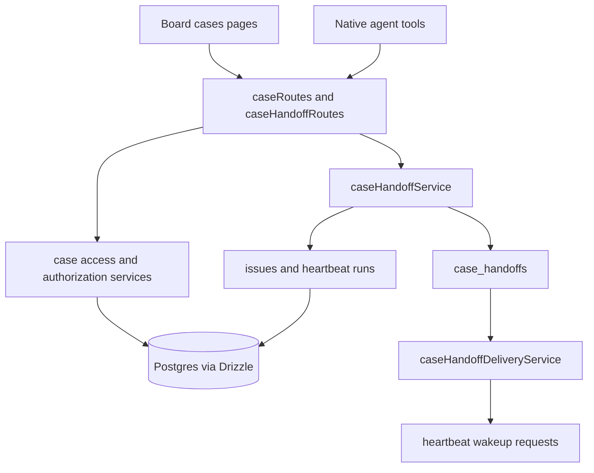
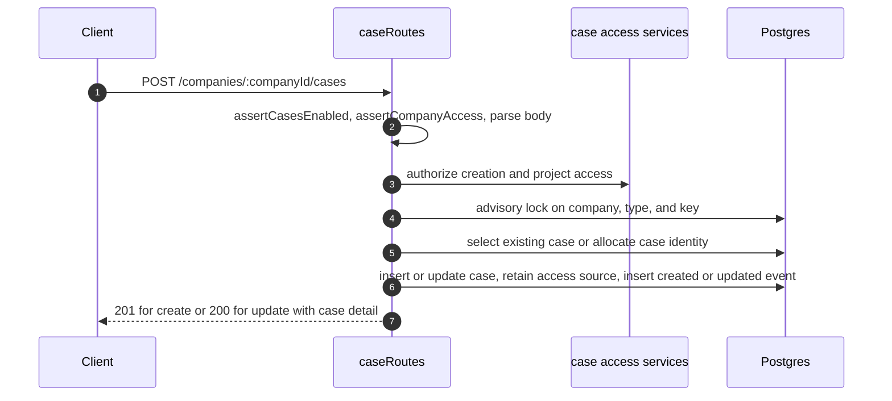
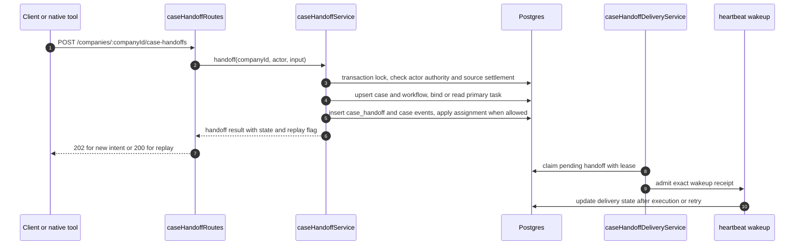
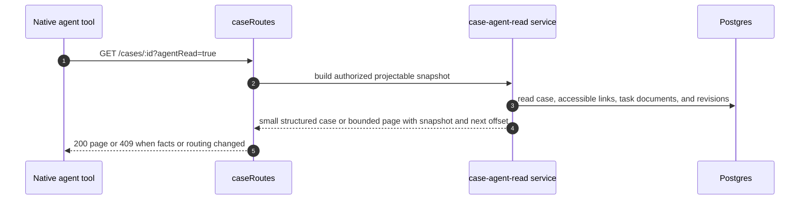

# Specification: Cases and Pipeline Cases

## Overview

Cases are implemented as company-scoped Drizzle tables, Express routes, application services, native agent tools, and read-only React pages.
A case is a persistent fact record that can bind to one ordinary issue as its primary task.
Agent transfers mutate task assignment and write a durable handoff row, while case facts, documents, labels, attachments, links, and events stay attached to the case.
Pipeline cases are separate schema tables for stage based records and are documented here because the feature title includes them.

## Architecture

The route layer calls `assertCasesEnabled`, verifies company access, parses zod schemas, and delegates authorization to case access services.
`server/src/services/case-access.ts` applies case read and write policy, retained access sources, low-trust checks, and project or issue boundaries.
`server/src/services/case-handoffs.ts` accepts handoffs inside transactions with advisory locks, idempotency keys, and input fingerprints.
`server/src/services/case-handoff-delivery.ts` treats the ledger as an outbox and coordinates wakeups, leases, retries, cancellation, and replay.
`server/src/services/case-agent-read.ts` builds bounded, reauthorized read pages for native tools.
The board pages use `ui/src/api/cases.ts` and render facts, work, documents, handoffs, and history without edit controls.

## Data Models

### Case

| Field | Type | Constraints | Description |
|---|---|---|---|
| id | uuid | PK, default random | Case identity |
| company_id | uuid | FK, not null | Company scope with cascade delete |
| project_id | uuid | FK, nullable | Project scope with set null delete |
| work_issue_id | uuid | FK, unique when present | Primary task for the case |
| phase | text | nullable | Current workflow phase copy |
| workflow_id | uuid | FK, nullable | Adopted company workflow |
| handoff_version | integer | not null, default 0 | Optimistic version for handoffs |
| case_number | integer | not null, unique per company | Human facing sequence number |
| identifier | text | not null, unique | Stable human identifier |
| case_type | text | not null | Case type with key uniqueness per company |
| key | text | nullable | Idempotency key with type and company uniqueness |
| title | text | not null | Case title |
| summary | text | nullable | Case summary |
| status | text | not null, default draft | Check constrained to draft, in_progress, in_review, approved, done, cancelled |
| fields | jsonb | not null, default empty object | Structured case facts |
| parent_case_id | uuid | FK, nullable | Parent case with set null delete |
| completed_at | timestamptz | nullable | Completion timestamp for terminal status |
| created_at | timestamptz | not null, default now | Creation time |
| updated_at | timestamptz | not null, default now | Update time |

### Case issue link

| Field | Type | Constraints | Description |
|---|---|---|---|
| id | uuid | PK, default random | Link identity |
| company_id | uuid | FK, not null | Company scope |
| case_id | uuid | FK, not null | Owning case |
| issue_id | uuid | FK, not null | Linked task |
| role | text | not null | Check constrained to origin, work, or reference |
| created_by_run_id | uuid | nullable | Source run attribution |

### Case event

| Field | Type | Constraints | Description |
|---|---|---|---|
| id | uuid | PK, default random | Event identity |
| company_id | uuid | FK, not null | Company scope |
| case_id | uuid | FK, not null | Owning case |
| kind | text | not null | Created, updated, field, status, link, document, child, attachment, label, or handoff event |
| actor_type | text | not null | user, agent, or system |
| actor_user_id | text | nullable | Human actor |
| actor_agent_id | uuid | FK, nullable | Agent actor |
| run_id | uuid | nullable | Run attribution |
| payload | jsonb | not null, default empty object | Event details |

### Case document, label, attachment, and access source

| Table | Key fields | Constraints | Description |
|---|---|---|---|
| case_documents | company_id, case_id, document_id, key | Unique per company, case, and key | Links a reusable document to a case |
| case_labels | company_id, case_id, label_id | Unique per case and label | Applies a company label to a case |
| case_attachments | company_id, case_id, asset_id | Asset unique | Links a stored asset to a case |
| case_access_sources | company_id, case_id, source_kind, source_id | Unique per case and source | Retains the task or project that grants access |

### Case handoff

| Field | Type | Constraints | Description |
|---|---|---|---|
| id | uuid | PK, default random | Handoff identity |
| company_id | uuid | FK, not null | Company scope |
| case_id | uuid | FK, not null | Owning case |
| issue_id | uuid | FK, not null | Primary task being routed |
| version | integer | not null, unique per case and company | Handoff sequence |
| from_agent_id | uuid | FK, nullable | Source agent with restricted delete |
| destination_kind | text | not null, default agent | agent or done |
| to_agent_id | uuid | FK, nullable | Required for agent destination |
| phase | text | not null | Destination phase |
| instructions | text | not null | Instructions delivered to the recipient |
| workflow_transition | jsonb | nullable | Captured workflow and phase movement |
| workflow_prompt | text | nullable | Preserved workflow text |
| actor_type | text | not null | agent, user, or system |
| actor_id | text | not null | Actor identity |
| actor_context | jsonb | nullable | Retained actor provenance |
| source_run_id | uuid | nullable | Source run attribution |
| expected_issue_status_version | bigint | nullable | Expected task status version |
| applied_issue_status_version | bigint | nullable | Applied task status version |
| wakeup_request_id | uuid | not null, unique | Durable wake admission |
| idempotency_key | text | not null, unique per company and actor | Caller replay key |
| input_fingerprint | text | not null | Canonical input hash |
| state | text | not null | awaiting_release, pending_dispatch, delivered, awaiting_completion, completed, or cancelled |
| attempt_count | integer | not null, default 0 | Delivery attempts |
| next_attempt_at | timestamptz | not null, default now | Retry time |
| lease_expires_at | timestamptz | nullable | Delivery worker lease |
| last_error_code | text | nullable | Last delivery failure code |
| last_error | text | nullable | Last delivery failure detail |

### Pipeline case

| Table | Key fields | Constraints | Description |
|---|---|---|---|
| pipelines | id, company_id, key, name | Company scoped | Stage workflow definition |
| pipeline_stages | id, company_id, pipeline_id, key, kind, position | Ordered per pipeline | Named stage |
| pipeline_cases | id, company_id, pipeline_id, stage_id, case_key, title, fields | Case key unique per pipeline | Stage based case record |
| pipeline_cases | workspace_ref, parent_case_id, version, pending_suggestion | Nullable | Workspace, parent, and suggestion state |
| pipeline_cases | lease_owner_type, lease_agent_id, lease_user_id, lease_token, lease_expires_at | Lease checks | Exclusive work claim |
| pipeline_cases | terminal_kind, terminal_at, retired_at, retired_reason, hidden_from_board_at | Nullable | Lifecycle state |
| pipeline_case_issue_links | case_id, issue_id, role, retired_at | Role check | Links a pipeline case to tasks with origin, conversation, work, or automation roles |
| pipeline_case_documents | case_id, document_id, key | Unique per case and key | Links documents to a pipeline case |
| pipeline_case_blockers | case_id, blocked_by_case_id | Unique pair, no self block | Case dependency |
| pipeline_automation_executions | case_id, automation_id, triggering_event_id, status | Unique idempotency tuple | Automation outcome for a pipeline case |

No active REST route or service for pipeline cases was found in this sync.
The schema and database tests are the evidence for pipeline case behavior.

## API Contracts

The normative contract is in [`api.yaml`](api.yaml).
The table below is a summary.
Request and response schemas and error bodies are in `api.yaml`.

| Method | Path | Purpose |
|---|---|---|
| POST | /api/companies/{companyId}/cases | Create or idempotently update a case |
| GET | /api/companies/{companyId}/cases | List authorized cases with filters and pagination |
| GET | /api/companies/{companyId}/cases/types | Discover readable case types |
| GET | /api/cases/{id} | Read case detail or a bounded native read page |
| PATCH | /api/cases/{id} | Patch case metadata, status, fields, parent, and labels |
| GET | /api/cases/{id}/events | Read case history events |
| GET | /api/cases/{id}/documents/{key} | Read a case document body and metadata |
| PUT | /api/cases/{id}/documents/{key} | Upsert a case document revision |
| DELETE | /api/cases/{id}/documents/{key} | Delete a case document link and document |
| GET | /api/cases/{id}/documents/{key}/revisions | List document revisions |
| POST | /api/cases/{id}/documents/{key}/lock | Lock a document |
| POST | /api/cases/{id}/documents/{key}/unlock | Unlock a document |
| POST | /api/cases/{id}/documents/{key}/revisions/{revisionId}/restore | Restore a document revision |
| GET | /api/cases/{id}/documents/{key}/annotations | List annotation threads |
| POST | /api/cases/{id}/documents/{key}/annotations | Create an annotation thread |
| GET | /api/cases/{id}/documents/{key}/annotations/{threadId} | Read an annotation thread |
| PATCH | /api/cases/{id}/documents/{key}/annotations/{threadId} | Resolve or reopen an annotation thread |
| POST | /api/cases/{id}/documents/{key}/annotations/{threadId}/comments | Reply to an annotation thread |
| POST | /api/cases/{id}/links | Link a task to a case |
| POST | /api/cases/{id}/attachments | Attach an uploaded asset to a case |
| GET | /api/issues/{issueId}/cases | List cases linked to a task |
| POST | /api/companies/{companyId}/case-handoffs | Start, replay, or complete a handoff |
| GET | /api/cases/{caseId}/handoffs | List handoff history |
| POST | /api/cases/{caseId}/handoffs/{handoffId}/retry | Retry pending delivery |
| POST | /api/cases/{caseId}/handoffs/{handoffId}/cancel | Cancel pending delivery |

Error codes shared across endpoints:

| Status | Code | Description |
|---|---|---|
| 400 | INVALID_INPUT | Query, body, document key, or identifier validation failed |
| 403 | FORBIDDEN | Actor lacks company access or case permission |
| 403 | cases_disabled | The instance has Cases turned off and no substitute route applies |
| 404 | NOT_FOUND | The case, document, handoff, or company is absent or hidden |
| 409 | CONFLICT | A snapshot, revision, upsert key, or concurrent mutation changed |
| 422 | UNPROCESSABLE | A handoff recipient, workflow seed, trust state, or routing policy is invalid |

## Sequences

### Case create or upsert

### Handoff acceptance and delivery

### Bounded native read

## Technical Decisions

| Decision | Choice | Rationale |
|---|---|---|
| Upsert identity | Advisory lock plus company, type, and key uniqueness | Concurrent writers converge on one passive case |
| Primary task | One unique work_issue_id per case | Handoffs route ordinary task assignment without copying the case |
| Durable routing | Ledger as outbox with idempotency and input fingerprint | Restarts and lost responses cannot create duplicate work |
| Delivery proof | Execution release and process settlement before handoff advance | Source work finishes before successor work starts |
| Native reads | Dedicated agentRead query with bounded pages | Large case facts and documents stay inside agent tool budgets without generic API access |
| Task documents | Case reads roll up metadata from authorized tasks | Case facts do not copy private task document bodies |
| Board UI | Read-only pages backed by production REST routes | Agents and REST callers author case data |
| Feature gate | Single instance setting with explicit disabled error | Experimental behavior stays off until an instance operator enables it |
| Pipeline cases | Separate schema retained without active route in this evidence | Artifact records current storage without inventing behavior |

## Risks and Unknowns

1. Pipeline case tables have schema and tests but no active route or service evidence.
2. No explicit latency or availability target is defined for case list or native read operations.
3. Handoff delivery depends on process settlement, adapter contracts, and durable wake admission, so regression risk is concentrated there.
4. Low-trust restrictions deliberately block automatic case authoring and execution context, which can surprise agents that expect ordinary task behavior.

## Out of Scope

- Case authoring controls in the board UI.
- A quarantine or promotion contract for cases.
- Active pipeline case API or UI behavior.
- Generic API tool access for native case document reads.
- Cross-company or instance-wide case listing.
