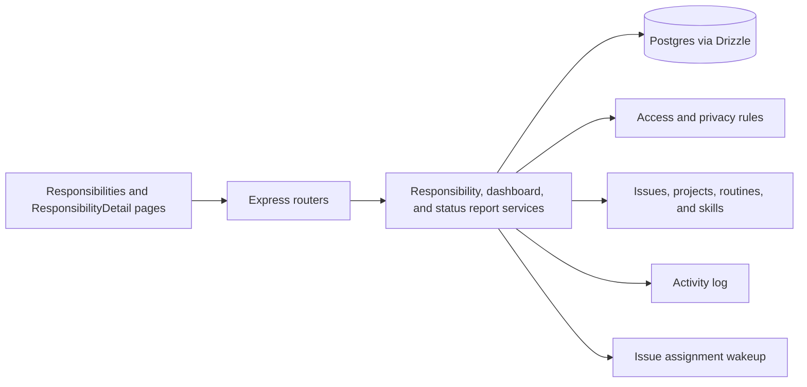
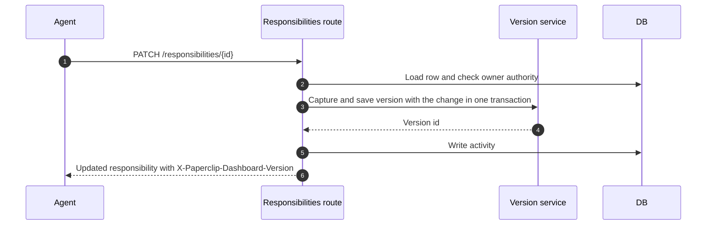
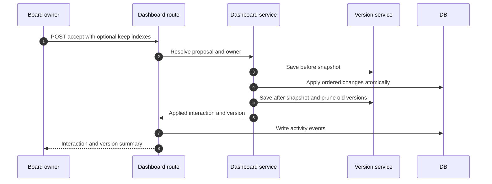
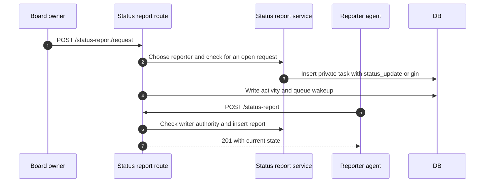

# Specification: Responsibilities and Status Reports

## Overview

The feature uses Express routers mounted under `/api`, Drizzle tables in Postgres, shared Zod schemas in `packages/shared`, and React Query pages in the UI.
Responsibilities, areas, links, status reports, and dashboard versions are company-scoped records.
An experimental setting gates every route.
UI pages show either the Dashboard overview or one responsibility, and the API supplies aggregate rollups and bounded lists.

## Architecture

The routers own authorization, validation, activity logging, and transaction boundaries.
The services own rollups, reporter selection, snapshots, and restore behavior.
The shared package owns the pure rules for bars, dashboard change validation, reporter choice, and status message shape.

## Data Models

### responsibility_areas

| Field | Type | Constraints | Description |
|---|---|---|---|
| id | uuid | PK, default random | Area identifier |
| companyId | uuid | Not null, FK companies cascade | Owning company |
| ownerUserId | text | Nullable | Auth user id, null on legacy rows that are hidden |
| title | text | Not null | Area name |
| description | text | Nullable | Private description |
| status | text | Not null, default active | One of proposed, active, archived |
| source | text | Not null, default manual | One of manual, onboarding |
| proposedByAgentId | uuid | Nullable FK agents set null | Agent that proposed the area |
| sortOrder | integer | Not null, default 0 | Display order |

A unique index on company, owner, and lowercased title applies to rows that are not archived.

### responsibilities

| Field | Type | Constraints | Description |
|---|---|---|---|
| id | uuid | PK, default random | Responsibility identifier |
| companyId | uuid | Not null, FK companies cascade | Owning company |
| ownerUserId | text | Not null | Auth user id of the person who owns it |
| areaId | uuid | Nullable FK areas set null | Filed area |
| title | text | Not null | Responsibility title |
| standard | text | Nullable | Bar sentence |
| metricKind | text | Nullable | One of volume, percentage, yes_no, range |
| metricName | text | Nullable | What is measured |
| metricUnit | text | Nullable | Unit symbol or word |
| metricTarget | numeric | Nullable | Target for volume and percentage bars |
| metricLow | numeric | Nullable | Lower bound for range bars |
| metricHigh | numeric | Nullable | Upper bound for range bars |
| metricCurrent | numeric | Nullable | Latest reading |
| metricDirection | text | Nullable | One of at_least, at_most |
| metricUpdatedAt | timestamp | Nullable | When the reading changed |
| runByAgentId | uuid | Nullable FK agents set null | Agent that runs the work |
| status | text | Not null, default proposed | One of proposed, active, let_go, dismissed |
| source | text | Not null, default manual | One of manual, onboarding |
| evidence | text | Nullable | Why an agent proposed it |
| healthOverride | text | Nullable | One of behind, at_risk, on_track |
| healthNote | text | Nullable | Owner reason for the override |
| sortOrder | integer | Not null, default 0 | Display order |
| proposedByAgentId | uuid | Nullable FK agents set null | Proposing agent |
| confirmedAt | timestamp | Nullable | When the owner confirmed it |

A composite foreign key keeps the area in the same company and under the same owner.
Indexes cover company, owner, status, and area.

### responsibility_links

| Field | Type | Constraints | Description |
|---|---|---|---|
| id | uuid | PK, default random | Link identifier |
| companyId | uuid | Not null, FK companies cascade | Owning company |
| responsibilityId | uuid | Not null, FK responsibilities cascade | Parent responsibility |
| projectId | uuid | Nullable FK projects cascade | Filed project |
| issueId | uuid | Nullable FK issues cascade | Filed task |
| routineId | uuid | Nullable FK routines cascade | Filed routine |
| skillId | uuid | Nullable FK company_skills cascade | Filed company skill |

A check constraint requires exactly one target id.
Unique indexes prevent the same target from being filed twice under one responsibility.

### responsibility_status_reports

| Field | Type | Constraints | Description |
|---|---|---|---|
| id | uuid | PK, default random | Report identifier |
| companyId | uuid | Not null, FK companies cascade | Owning company |
| responsibilityId | uuid | Not null, FK responsibilities cascade | Parent responsibility |
| agentId | uuid | Nullable FK agents set null | Agent author |
| userId | text | Nullable | Person author |
| status | text | Not null | One of behind, at_risk, on_track, unknown |
| message | text | Not null | One plain line saying why |
| detail | text | Nullable | Optional extra sentences |
| createdAt | timestamp | Not null, default now | When it was written |

A check constraint forbids both author ids on one row.
An index on responsibility and descending creation time supports the current report read.

### responsibility_dashboard_versions

| Field | Type | Constraints | Description |
|---|---|---|---|
| id | uuid | PK, default random | Version identifier |
| companyId | uuid | Not null, FK companies cascade | Owning company |
| ownerUserId | text | Not null | Dashboard owner |
| cause | text | Not null | One of change_set, person, restore |
| summary | text | Not null | One line describing the change |
| snapshot | jsonb | Not null | Areas and responsibilities at that moment |
| snapshotHash | text | Not null | Hash used to skip identical versions |
| actorUserId | text | Nullable | Person who caused it |
| actorAgentId | uuid | Nullable FK agents set null | Agent who caused it |
| issueId | uuid | Nullable FK issues set null | Dashboard conversation |
| interactionId | uuid | Nullable | Proposal that was applied |
| previousVersionId | uuid | Nullable FK versions set null | Version Undo restores |
| restoredFromVersionId | uuid | Nullable FK versions set null | Version that was restored |
| createdAt | timestamp | Not null, default now | When it was saved |

The snapshot type is `ResponsibilityDashboardSnapshot` from `packages/shared/src/responsibility-dashboard.ts`.
Older snapshots may lack links, description, runByAgentId, evidence, or health fields, and restore leaves those fields alone.

### responsibility_metrics and responsibility_metric_readings

These tables hold supporting metrics and their readings.
They are owned by the responsibility metrics module and are used by the detail page beside the primary bar.

## API Contracts

The normative contract is in [`api.yaml`](api.yaml) (OpenAPI 3), written alongside this document whenever the specification defines an API surface.
The table below is a summary, and `api.yaml` holds the request and response schemas.

| Method | Path | Purpose |
|---|---|---|
| GET | `/api/companies/{companyId}/responsibilities` | Read one owner's areas, responsibilities, proposals, totals, and loose work |
| POST | `/api/companies/{companyId}/responsibilities` | Create a responsibility or return the live one with the same title |
| GET | `/api/responsibilities/{id}` | Read one responsibility with its filed work and skills |
| PATCH | `/api/responsibilities/{id}` | Update fields or post a metric reading |
| DELETE | `/api/responsibilities/{id}` | Delete a responsibility, with an agent confirmation card when needed |
| POST | `/api/responsibilities/{id}/links` | File one project, task, routine, or skill |
| DELETE | `/api/responsibilities/{id}/links/{linkId}` | Unfile one link |
| POST | `/api/responsibilities/{id}/file` | File several items and optionally move them |
| POST | `/api/responsibilities/{id}/unfile` | Unfile several items by kind and id |
| POST | `/api/responsibilities/{id}/delegate` | Create a task under the responsibility and wake its assignee |
| GET | `/api/companies/{companyId}/responsibility-links/lookup` | Find responsibilities that contain one item |
| GET | `/api/companies/{companyId}/responsibility-areas` | Read areas, optionally including archived ones |
| POST | `/api/companies/{companyId}/responsibility-areas` | Create or reuse an area |
| PATCH | `/api/responsibility-areas/{id}` | Rename, describe, reorder, archive, or restore an area |
| DELETE | `/api/responsibility-areas/{id}` | Delete an area and optionally move its responsibilities |
| GET | `/api/companies/{companyId}/responsibility-dashboard` | Read the dashboard conversation state |
| GET | `/api/companies/{companyId}/responsibility-dashboard/versions` | Read the version list and checkpoint manual changes |
| POST | `/api/companies/{companyId}/responsibility-dashboard/conversation` | Start or reopen a dashboard conversation |
| POST | `/api/issues/{id}/dashboard-changes` | Propose an ordered change set from the conversation agent |
| POST | `/api/issues/{id}/dashboard-changes/{interactionId}/accept` | Apply all or selected changes |
| POST | `/api/issues/{id}/dashboard-changes/{interactionId}/decline` | Decline a proposal |
| POST | `/api/responsibility-dashboard-versions/{id}/restore` | Restore a saved version |
| GET | `/api/companies/{companyId}/responsibilities/status-reports` | Read current reports for all active responsibilities of an owner |
| GET | `/api/responsibilities/{id}/status-report` | Read current report, reporter, request state, and history |
| POST | `/api/responsibilities/{id}/status-report` | Write a status report |
| POST | `/api/responsibilities/{id}/status-report/request` | Ask the reporter for an update |

Error codes shared across endpoints:

| Status | Code | Description |
|---|---|---|
| 404 | `responsibilities_disabled` | The experimental setting is off |
| 404 | `Responsibility not found` | The row is absent or outside the reader's owner scope |
| 400 | `INVALID_INPUT` | Zod validation refused the request body or query |
| 403 | `FORBIDDEN` | The actor lacks company scope or owner authority |
| 409 | `responsibility_status_not_active` | A status operation targeted an inactive responsibility |
| 422 | `responsibility_status_no_agent` | No agent can take work, so the owner must write the status |

## Sequences

### Agent changes a responsibility for an owner

### A person applies dashboard changes

### A status update is requested and written

## Technical Decisions

| Decision | Choice | Rationale |
|---|---|---|
| Storage | Drizzle tables in Postgres with cascading company foreign keys | Company boundaries and referential integrity stay in the database |
| Validation | Zod schemas in `packages/shared` | Server, agent prompts, and UI use the same rules |
| Feature gate | `enableResponsibilities` experimental setting | The dashboard can ship without changing the default product |
| Agent authority | Check company scope, directing user, authorizing user, and on-behalf-of user | An agent cannot use another person's dashboard by naming them |
| Change safety | Version snapshots before and after applied changes with a 30-version cap | A person can undo an agent change without unbounded storage |
| Link model | One link row with exactly one target id | Projects, tasks, routines, and skills stay in their own tables |
| Reporter choice | Pure shared function over agent work counts and activity | Reads stay deterministic and testable without database code |
| Private conversations | Issue origin kinds and `responsibleUserId` with query conditions | Personal dashboard tasks stay out of company-wide lists |
| Read performance | Batched service queries with fixed query counts | Overview pages avoid one query per responsibility |

## Risks and Unknowns

1. The written status and the metric-derived health can disagree, and the inspected code does not define one rule for every view.
2. Renaming a shared area splits it into per-owner copies, so later divergence between those copies is possible.
3. Restoring an older version cannot restore fields that the snapshot does not hold, such as filed skills in early versions.
4. An agent's authority depends on run metadata, and a missing directing user limits the agent to proposals.
5. Version pruning at 30 versions can remove the point a person wants to restore after a long sequence of changes.
6. Company administrators cannot read or edit another owner's dashboard through these routes, which the route tests confirm but the product rationale is not documented here.

## Out of Scope

- The bar conversation flow and supporting metric definitions are owned by the responsibility bars and metrics modules.
- Automation conversations and standing checks are owned by the responsibility automation module.
- Where things stand summaries are owned by the responsibility summaries module.
- The responsible user invariant on tasks and runs is owned by a separate product rule.
