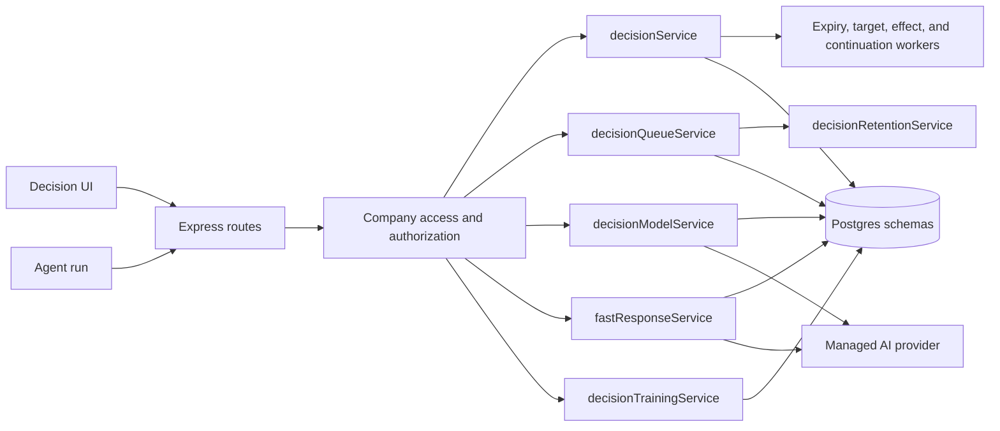
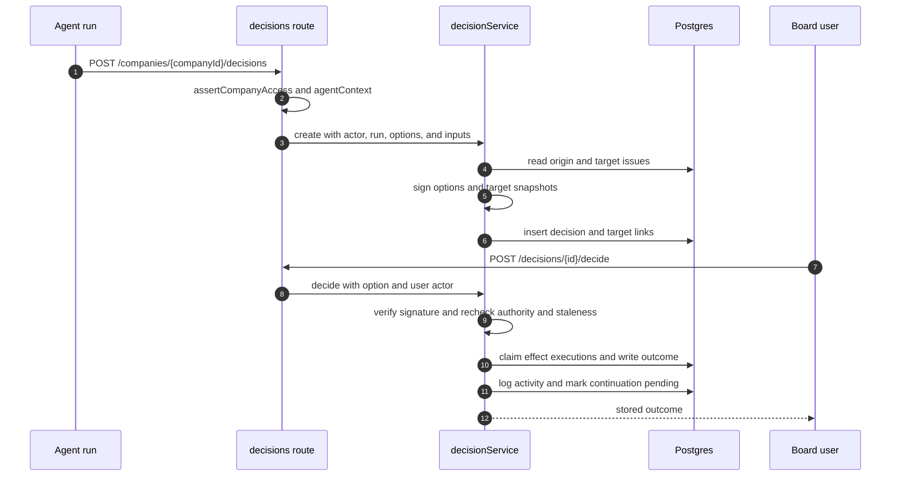
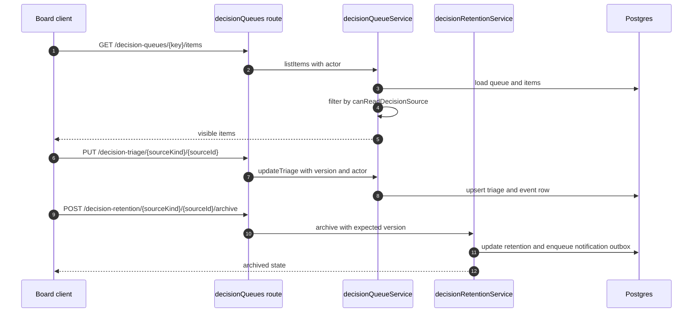
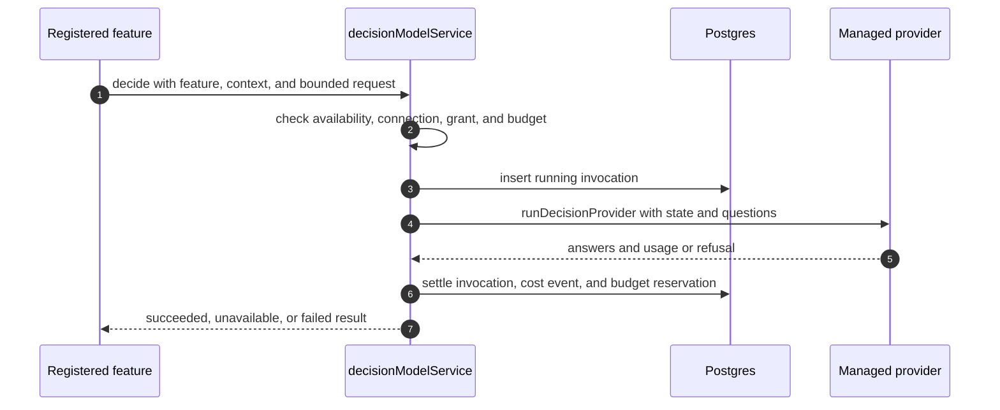
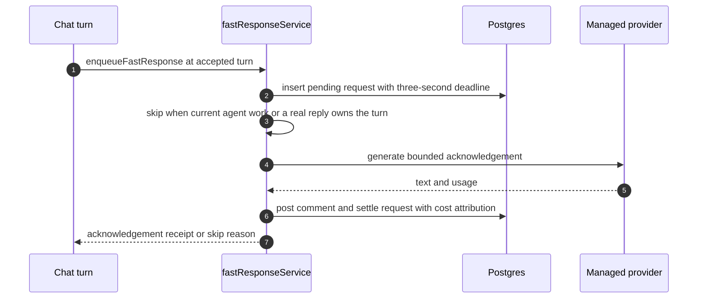

# Specification: Decision Workflows

## Overview

The implementation is split across five Express route modules and their services under `server/src/routes` and `server/src/services`.
Decision proposals are stored in Postgres with signed option and target snapshots, and board answers recheck authority and staleness before effects run at most once.
Decision queues, triage, and retention are company-scoped tables with versioned updates and notification outbox rows for archive delivery.
Decision models and fast responses use managed AI connections through shared provider adapters, and they record content-free invocation accounting.
Training examples preserve a cutoff-bounded snapshot with notes and a retention policy for JSONL export.
The UI exposes a decisions desk, queue pages, decision cards, settings forms, and history views from the same shared contracts.

## Architecture

The route layer checks company access, board or agent identity, and fine-grained authorization before it calls a service.
The service layer owns provider calls, signatures, idempotency, transaction boundaries, and background work registration.
Shared Zod validators in `packages/shared` define request shapes for decisions, queues, models, training, and fast responses.

## Data Models

### Decision bundle

| Field | Type | Constraints | Description |
|---|---|---|---|
| id | uuid | PK, default random | Bundle identity |
| companyId | uuid | FK, not null | Company scope |
| title | text | not null | Bundle title |
| summary | text | not null | Bundle summary |
| originAgentId | uuid | FK, not null | Proposing agent |
| originIssueId | uuid | FK, not null | Origin issue |
| originRunId | uuid | FK, not null | Origin heartbeat run |
| createdAt | timestamptz | not null, default now | Creation time |

### Decision

| Field | Type | Constraints | Description |
|---|---|---|---|
| id | uuid | PK, default random | Decision identity |
| companyId | uuid | FK, not null | Company scope |
| bundleId | uuid | FK, nullable | Optional bundle membership |
| originAgentId | uuid | FK, not null | Proposing agent |
| originIssueId | uuid | FK, not null | Origin issue |
| originRunId | uuid | FK, not null | Origin heartbeat run |
| ruleKey | text | nullable | Grouping key for statistics |
| title | text | not null | Decision title |
| body | text | not null | Decision body |
| options | jsonb | not null, max 8 options | Signed options with effects |
| inputs | jsonb | nullable, max 4 inputs | Optional user fields |
| status | text | not null, default open | open, decided, expired, or cancelled |
| executionStatus | text | nullable | Effect execution state |
| chosenOptionId | text | nullable | Answered option |
| inputValues | jsonb | nullable | Recorded user inputs |
| decidedByUserId | text | nullable | Deciding board user |
| decidedAt | timestamptz | nullable | Decision time |
| expiresAt | timestamptz | not null | Deadline used by expiry work |
| idempotencyKey | text | unique per company | Create replay key |
| signedSpec | text | not null | Signature over options and target snapshots |
| targetSnapshots | jsonb | not null | State captured at proposal time |
| continuationPolicy | text | not null, default none | none or wake_origin_agent |
| metadata | jsonb | not null, default empty | Provenance and receipt metadata |
| createdAt | timestamptz | not null, default now | Creation time |
| updatedAt | timestamptz | not null, default now | Last write time |

### Decision targets and effects

| Field | Type | Constraints | Description |
|---|---|---|---|
| decisionTargetIssues.decisionId | uuid | FK, part of PK | Decision link |
| decisionTargetIssues.issueId | uuid | FK, part of PK | Target issue link |
| decisionTargetIssues.companyId | uuid | FK, not null | Company scope |
| decisionEffectExecutions.id | uuid | PK, default random | Execution identity |
| decisionEffectExecutions.decisionId | uuid | FK, not null | Owning decision |
| decisionEffectExecutions.effectIndex | integer | unique with decisionId | Position in the chosen option |
| decisionEffectExecutions.effectType | text | not null | Effect discriminator |
| decisionEffectExecutions.targetIssueId | uuid | FK, not null | Target issue |
| decisionEffectExecutions.status | text | not null, default claimed | claimed, succeeded, failed, or skipped |
| decisionEffectExecutions.result | jsonb | nullable | Effect result |
| decisionEffectExecutions.error | text | nullable | Failure detail |
| decisionEffectExecutions.executedAt | timestamptz | nullable | Execution time |

### Decision queues and triage

| Field | Type | Constraints | Description |
|---|---|---|---|
| decisionQueues.id | uuid | PK, default random | Queue identity |
| decisionQueues.companyId | uuid | FK, not null | Company scope |
| decisionQueues.key | text | unique per company | URL-safe kebab-case key |
| decisionQueues.title | text | not null | Queue title |
| decisionQueues.description | text | nullable | Queue description |
| decisionQueues.retentionDays | integer | nullable, 1 to 3650 | Retention window |
| decisionQueues.seedRules | jsonb | not null, default empty | Starter signal rules |
| decisionQueues.seedRulesEnabled | boolean | not null, default false | Seed materialization switch |
| decisionQueueItems.id | uuid | PK, default random | Item identity |
| decisionQueueItems.queueId | uuid | FK, not null | Owning queue |
| decisionQueueItems.sourceKind | text | not null | Attention source kind |
| decisionQueueItems.sourceId | text | not null | Attention source id |
| decisionQueueItems.responsibleUserId | text | nullable | Accountable board user |
| decisionTriage.id | uuid | PK, default random | Triage identity |
| decisionTriage.sourceKind | text | unique with company and sourceId | Attention source kind |
| decisionTriage.sourceId | text | unique with company and sourceKind | Attention source id |
| decisionTriage.decideBy | text | nullable | today, this_week, whenever, or date |
| decisionTriage.decideByDate | date | nullable | Explicit decide-by date |
| decisionTriage.snoozedUntil | timestamptz | nullable | Snooze deadline |
| decisionTriage.version | integer | not null, default 1 | Optimistic update version |
| decisionTriageEvents.id | uuid | PK, default random | Event identity |
| decisionTriageEvents.action | text | not null | Recorded triage or queue action |
| decisionTriageEvents.details | jsonb | not null, default empty | Event details |
| decisionTriageEvents.createdAt | timestamptz | not null, default now | Event time |

### Decision retention

| Field | Type | Constraints | Description |
|---|---|---|---|
| decisionRetention.id | uuid | PK, default random | Retention identity |
| decisionRetention.companyId | uuid | FK, not null | Company scope |
| decisionRetention.sourceKind | text | unique with company and sourceId | Attention source kind |
| decisionRetention.sourceId | text | unique with company and sourceKind | Attention source id |
| decisionRetention.sourceActivityAt | timestamptz | not null | Last source activity |
| decisionRetention.keep | boolean | not null, default false | Manual keep flag |
| decisionRetention.archivedAt | timestamptz | nullable | Archive time |
| decisionRetention.archivedReason | text | nullable | Archive reason |
| decisionRetention.version | integer | not null, default 1 | Current manifest version |
| decisionRetention.archiveVersion | integer | not null, default 0 | Archive generation |
| decisionArchiveNotificationOutbox.id | uuid | PK, default random | Notification identity |
| decisionArchiveNotificationOutbox.archiveVersion | integer | not null | Archived generation |
| decisionArchiveNotificationOutbox.originAgentId | uuid | FK, not null | Agent to notify |
| decisionArchiveNotificationOutbox.status | text | not null, default pending | pending, delivering, or delivered |
| decisionArchiveNotificationOutbox.attemptCount | integer | not null, default 0 | Delivery attempts |

### Decision model and fast response settings

| Field | Type | Constraints | Description |
|---|---|---|---|
| companyDecisionModels.companyId | uuid | PK, FK | Company scope |
| companyDecisionModels.connectionId | uuid | nullable | Managed connection |
| companyDecisionModels.grantId | uuid | nullable | Connection grant |
| companyDecisionModels.enabled | boolean | not null, default false | Feature switch |
| companyDecisionModels.allowBackground | boolean | not null, default true | Background sponsorship switch |
| companyDecisionModels.provider | text | nullable | openai or openrouter |
| companyDecisionModels.model | text | nullable | Configured model id |
| companyFastResponses.companyId | uuid | PK, FK | Company scope |
| companyFastResponses.connectionId | uuid | nullable | Managed connection |
| companyFastResponses.grantId | uuid | nullable | Connection grant |
| companyFastResponses.model | text | nullable | Configured model id |
| companyFastResponses.provider | text | nullable | AI provider |
| companyFastResponses.enabled | boolean | not null, default false | Feature switch |
| companyFastResponses.allowSponsored | boolean | not null, default true | Sponsored receipt switch |

### Invocation accounting

| Field | Type | Constraints | Description |
|---|---|---|---|
| decisionInvocations.id | uuid | PK, default random | Invocation identity |
| decisionInvocations.companyId | uuid | FK, not null | Company scope |
| decisionInvocations.feature | text | not null | Registered feature id |
| decisionInvocations.actorType | text | not null | board or agent |
| decisionInvocations.actorId | text | not null | Acting identity |
| decisionInvocations.connectionId | uuid | not null | Credential attribution |
| decisionInvocations.grantId | uuid | not null | Grant attribution |
| decisionInvocations.provider | text | not null | Provider attribution |
| decisionInvocations.model | text | not null | Model attribution |
| decisionInvocations.questionTypes | jsonb | not null | Question kinds only |
| decisionInvocations.status | text | not null, default running | running, succeeded, failed, or unknown |
| decisionInvocations.costEventId | uuid | FK, nullable | Cost event link |
| decisionInvocations.durationMs | integer | nullable | Provider duration |
| decisionInvocations.inputTokens | integer | nullable | Reported input tokens |
| decisionInvocations.outputTokens | integer | nullable | Reported output tokens |
| fastResponseRequests.id | uuid | PK, default random | Fast response identity |
| fastResponseRequests.companyId | uuid | FK, not null | Company scope |
| fastResponseRequests.sourceKey | text | unique per company | Turn deduplication key |
| fastResponseRequests.status | text | not null, default pending | pending, running, succeeded, failed, unknown, or skipped |
| fastResponseRequests.publicationStatus | text | not null, default pending | Comment publication state |
| fastResponseRequests.expiresAt | timestamptz | not null | Three-second display deadline |
| fastResponseRequests.commentId | uuid | nullable | Posted acknowledgement comment |
| fastResponseRequests.costEventId | uuid | FK, nullable | Cost event link |

### Decision training example

| Field | Type | Constraints | Description |
|---|---|---|---|
| id | uuid | PK, default random | Example identity |
| companyId | uuid | FK, not null | Company scope |
| sourceKind | text | not null | interaction, approval, or execution_decision |
| sourceId | uuid | not null | Source identity |
| issueId | uuid | FK, not null | Owning issue |
| cutoffAt | timestamptz | not null | Snapshot boundary |
| notes | text | not null, default empty | Author notes |
| notesHistory | jsonb | not null, default empty | Note revisions |
| decisionOutcome | text | nullable | Recorded label outcome |
| retentionPolicy | text | not null, default scrub_deleted_comments_v1 | Export policy |
| snapshot | jsonb | not null | Cutoff-bounded state snapshot |
| createdByUserId | text | not null | Example author |

## API Contracts

The normative contract lives in [`api.yaml`](api.yaml) (OpenAPI 3), written alongside this document because the feature defines an API surface.
The table below is a summary, and request and response schemas live in `api.yaml`.

| Method | Path | Purpose |
|---|---|---|
| POST | /api/companies/{companyId}/decision-archive-proposals | Propose a signed bulk archive decision |
| POST | /api/companies/{companyId}/decisions | Create a decision from an agent run |
| POST | /api/companies/{companyId}/decision-bundles | Create a bundle of decisions |
| GET | /api/companies/{companyId}/decisions | List decisions with filters |
| GET | /api/companies/{companyId}/decisions/stats | Read grouped decision statistics |
| GET | /api/decisions/{id} | Read one decision outcome |
| POST | /api/decisions/{id}/decide | Answer a decision |
| POST | /api/decisions/{id}/dismiss | Dismiss a decision |
| POST | /api/decisions/{id}/cancel | Cancel a decision |
| GET | /api/companies/{companyId}/decision-model | Read decision model settings, choices, and management flag |
| PUT | /api/companies/{companyId}/decision-model | Configure the company decision model |
| GET | /api/companies/{companyId}/decision-model/availability | Read decision model availability |
| POST | /api/companies/{companyId}/decision-model/test | Run the fixed decision sample |
| GET | /api/companies/{companyId}/decision-model/history | Read decision invocation history |
| GET | /api/companies/{companyId}/decision-queue-seed-rules | List starter queue seed rules |
| GET | /api/companies/{companyId}/decision-queues | List company decision queues |
| POST | /api/companies/{companyId}/decision-queues | Create or reuse a decision queue |
| PATCH | /api/companies/{companyId}/decision-queues/{key} | Update a decision queue |
| GET | /api/companies/{companyId}/decision-queues/{key}/items | List visible queue items |
| POST | /api/companies/{companyId}/decision-queues/{key}/items | Add a source to a queue |
| DELETE | /api/companies/{companyId}/decision-queues/{key}/items/{sourceKind}/{sourceId} | Remove a source from a queue |
| GET | /api/companies/{companyId}/decision-triage/{sourceKind}/{sourceId} | Read triage for a source |
| PUT | /api/companies/{companyId}/decision-triage/{sourceKind}/{sourceId} | Update decide-by and snooze values |
| PATCH | /api/companies/{companyId}/decision-retention/{sourceKind}/{sourceId} | Set the keep flag |
| POST | /api/companies/{companyId}/decision-retention/{sourceKind}/{sourceId}/archive | Archive a reviewed source |
| POST | /api/companies/{companyId}/decision-retention/{sourceKind}/{sourceId}/revive | Revive an archived source |
| POST | /api/companies/{companyId}/decision-training | Create a training example |
| POST | /api/companies/{companyId}/decision-training/preview | Preview a training snapshot |
| GET | /api/companies/{companyId}/decision-training | List training examples |
| GET | /api/companies/{companyId}/decision-training/export.jsonl | Export training examples as JSONL |
| GET | /api/decision-training/{id} | Read one training example |
| PATCH | /api/decision-training/{id} | Update training notes |
| DELETE | /api/decision-training/{id} | Delete a training example |
| GET | /api/companies/{companyId}/fast-response | Read fast response settings, choices, and management flag |
| PUT | /api/companies/{companyId}/fast-response | Configure fast responses |
| GET | /api/companies/{companyId}/fast-response/models | List models for a connection |
| GET | /api/companies/{companyId}/fast-response/availability | Read fast response availability |
| POST | /api/companies/{companyId}/fast-response/test | Run the fixed fast response sample |
| GET | /api/companies/{companyId}/fast-response/history | Read fast response history |

Error codes shared across endpoints:

| Status | Code | Description |
|---|---|---|
| 400 | INVALID_INPUT | Zod validation failed for a body, query, path parameter, or source identity |
| 403 | FORBIDDEN | Company access, board or agent identity, connection management, or authorization check failed |
| 404 | NOT_FOUND | The entity does not exist or the actor may not read it |
| 409 | CONFLICT | An idempotent or versioned write conflicts with stored state |
| 422 | UNPROCESSABLE | A signed spec, archive manifest, expiry, or staleness precondition failed |
| 429 | RATE_LIMITED | The open decision cap was exceeded |

## Sequences

### Decision proposal and answer

### Queue, triage, and retention

### Decision model invocation

### Fast response turn

## Technical Decisions

| Decision | Choice | Rationale |
|---|---|---|
| Signed decision specs | HMAC over options and target snapshots | Detects tampering after a decision is shown to a user |
| Idempotency by key | Unique company and key with outcome replay | Prevents duplicate effects under concurrent or retried requests |
| Bounded effects | At most eight options and ten effects per option | Keeps review, signing, and execution bounded |
| Strict and lenient staleness | Strict options fail closed, lenient options recheck authority only | Lets destructive or structural effects avoid stale state while allowing safe updates |
| Versioned triage and retention | Integer versions on triage and retention rows | Rejects stale board updates without locking the whole queue |
| Attention manifest hash | Canonical hash of sorted manifest entries | Binds bulk archive acceptance to the exact reviewed list |
| Managed native connections | OpenAI and OpenRouter native API key connections only | Keeps decision and fast response credentials inside the managed connection system |
| Content-free accounting | Invocation and request rows store attribution and usage only | Preserves privacy while supporting cost reporting |
| At-least-once background work | Workers claim rows and settle by idempotent keys | Recovers crashes without replaying provider work or effects |
| Server-owned sample requests | Fixed decision and fast response test payloads | Prevents clients from supplying prompts, models, or identities for settings tests |
| Cutoff training snapshots | Captured state before the decision cutoff with retention policy | Produces reviewable examples without later comments or deleted content |

## Risks and Unknowns

1. Effect execution depends on current authorization and target state, so a valid decision can become partially fulfilled.
2. Open decision and queue reads are bounded by configured caps, and those caps may need tuning for large companies.
3. Provider pricing depends on usage receipts and supported rate tables, and unknown rates remain unpriced.
4. Fast response text is generated from bounded context, so acknowledgement quality depends on the selected model.
5. Archive notification delivery is at-least-once, so it must stay idempotent per archive version and origin agent.
6. The product status of the seven-day default expiry, thirty-day maximum, and three-second acknowledgement deadline is not stated in code.
7. The intended consumer of decision training JSONL exports is not stated in code.

## Out of Scope

- Approval decisions tracked in FEAT-0005.
- Standalone notification system behavior beyond decision archive delivery.
- Draft plan documents and plan revision authoring.
- Agent runtime adapter implementation.
- Instance-wide AI connection management beyond the settings surfaces consumed here.
